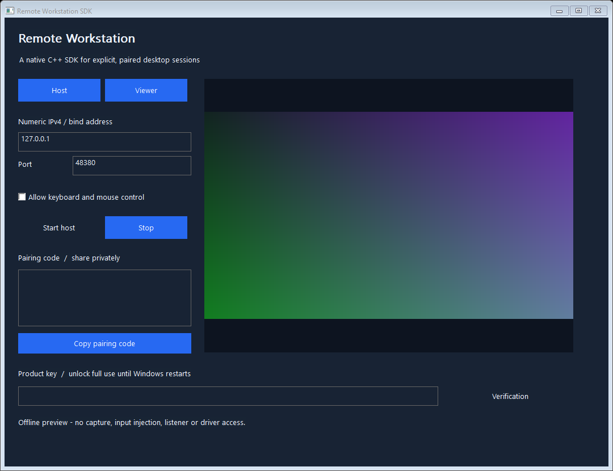

# Remote Workstation SDK - Native Windows Desktop Streaming

**Build an explicitly paired desktop viewer with a small C++ API.**

Remote Workstation supplies a native host/viewer application, C++ SDK, console
tools and installer source. A host shares its primary desktop only after the
operator starts it and gives the viewer a fresh pairing code. Keyboard and mouse
control require a separate host opt-in and an explicit viewer opt-in.



The initial edition targets **Windows 10 version 2004/build 19041+ or Windows 11, x64 only**. Its bounded LAN implementation
uses Windows desktop capture, lossless frame compression and Schannel TLS.
The separate Titan SDK Runtime provides the per-boot demo and signed full-use
activation. The complete release includes that Microsoft-signed package;
source builds without that payload refuse installation.

The release ZIP contains the application, CLI, example, both single-file setup
executables and matching opaque Microsoft-signed packages under `Driver/`.
Microsoft signing covers the driver packages; the user-mode EXEs are separate.
The supported scope and executed qualification are documented in
[validation](docs/VALIDATION.md).

## Install and connect

1. Extract the [complete release ZIP](https://github.com/titanfyre/Remote-Workstation-SDK/releases). `RemoteWorkstation.exe --preview` shows the
   labelled interface without capture, input, driver access or a listener.
2. With the complete signed bundle, run `RemoteWorkstationSetup.exe` on both
   Windows PCs and choose **Install / reinstall**. Restart only if requested.
3. Open `RemoteWorkstation.exe` as administrator. On the host choose its exact
   LAN IPv4 address, a port and whether to allow control. Choose **Start host**.
   The default address `127.0.0.1` accepts this PC only; no listener starts at
   application launch and the program creates no firewall rule.
4. Share **Copy pairing code** privately with the intended viewer. The code
   includes the exact certificate fingerprint and a random session secret.
5. On the other PC choose **Viewer**, enter the host's IPv4, matching port and
   pairing code, then choose **Connect viewer**. Frames appear in the right pane.
6. To control, the host must have allowed control before starting. The viewer
   enables **Send keyboard and mouse** and clicks the view to focus it. Disabling
   control disconnects the viewer to release held inputs. **Stop** and application
   closure end the session. Changing host permissions requires a new host session.

Allow the chosen application/port through your organization's Windows Firewall
policy if needed. The SDK never changes firewall or network policy for you.
Use the initial edition on an authorized LAN; it supplies no Internet relay,
automatic port forwarding, unattended service or NAT traversal.

```powershell
RemoteWorkstationSetupConsole.exe /install
RemoteWorkstationSetupConsole.exe /status
RemoteWorkstationCLI.exe host 192.168.1.10
RemoteWorkstationCLI.exe view 192.168.1.10 FINGERPRINT:SESSION_SECRET
RemoteWorkstationSetupConsole.exe /uninstall
```

Setup copies only its three application executables into
`Program Files\TitanCSA\RemoteWorkstation`. Keep the extracted setup for removal;
the initial app installer does not register a Windows Apps entry or shortcut.
Uninstall preserves the shared runtime used by the other three SDKs. Ownership
markers, exact file allow-lists and non-reparse directories bound app replacement
and removal; unexpected files are preserved and reported. Exit code `3010`
requests a manual restart.

## Demo and full activation

The same installed runtime supports a **one-hour demo per product and Windows
boot**, shared by all processes. Its kernel-owned timer begins on the first real
Host or Viewer use, not on an offline preview. Closing/reopening the application
does not reset the timer. Expiry stops supplied sessions safely.

For commercial use, OEM redistribution or integration support, add
**`titancsa` on Discord** and request a Remote Workstation product key. Paste it
into the application and choose **Verification**, or call:

```cpp
auto error = RemoteWorkstation::Verification(productKey);
if (!error.empty()) std::cerr << error << '\n';
```

An empty English error string means the runtime accepted a fresh server-signed
proof and activated full Remote Workstation use **until Windows restarts**.
There is no one-hour cutoff in full mode. After reboot, call `Verification(key)`
again. No key is embedded in the SDK or automatically saved. Disabling a key
refuses future activations; it does not revoke rights already accepted for the
current boot. The authority's private signing key never leaves the server.

The runtime licenses this supplied implementation. Windows capture, compression
and input APIs remain public Windows facilities; independently written or
modified user-mode code can use them without this SDK. This is not a universal
Windows API lock, machine binding or unbreakable DRM.

## Minimal C++ viewer

Copy `SDK/`, compile its `.cpp` files with C++17 and link the libraries in
`CMakeLists.txt`. `Connect` starts or checks the shared runtime demo automatically.

When combining Titan SDKs in one app, compile one copy of the shared `License.cpp`.
For Remote Workstation and USB-over-IP together, also compile only one shared `Transport.cpp`.

```cpp
#include "RemoteWorkstation.h"
#include <iostream>

RemoteWorkstation::Viewer viewer;
auto error = viewer.Connect("192.168.1.10", 48380, pairingCode);
if (!error.empty()) { std::cerr << error; return; }

auto frame = viewer.Receive();
// frame.width, frame.height and frame.bgra describe one top-down BGRA image.
// Scope exit disconnects this viewer.
```

`Host::Start(options)`, `Viewer::Connect(...)` and `Verification(key)` return an
English error string, empty on success. `Viewer::Receive(inputs)` returns a frame
or throws a detailed `std::runtime_error`. Inputs are optional and limited to64
validated records per request. Pointer coordinates are normalized `0..65535`;
wheel deltas are signed. The host validates all records before calling a sink.
Track repeated keys in your application if autorepeat is required.

`HostOptions::capture` and `HostOptions::input` let an integration supply its own
bounded pixel/control callbacks. Callbacks run on the host worker, must return
promptly and must not re-enter the host's lifecycle methods or destroy it.
Serialize Host lifecycle calls and viewer `Connect`/`Receive`; `Viewer::Stop`
can interrupt its active TLS operation. There is one viewer and one in-flight
frame request, with no growing frame queue. The sample app bounds input buffering
and disconnects on overflow to release held keys.

## Scope and transport

- One primary desktop, up to 1280x720 BGRA; default 960x540 at 15 frames/s,
  configurable 1..30. Capture uses a documented GDI path and lossless Windows
  compression, not a GPU video codec or a latency guarantee.
- Same interactive Windows session only. Standard `SendInput` is used for the
  optional control path. UIPI, secure desktop, logon/session and protected-content
  boundaries remain in force. No claim of lower-level Interceptor injection is
  made for this edition.
- Numeric IPv4, explicit TCP bind, TLS 1.2 with strong negotiated encryption,
  exact SHA-256 server-certificate pin and a random 128-bit application pairing
  secret. No trust-store certificate is installed. A pairing code is valid only
  for its current host session and certificate validity window of 24 hours.
- Windows 10 Schannel compatibility uses a randomly named current-user RSA/AES
  CSP private-key container. It is deleted at normal host cleanup. A terminated
  process or machine crash can leave its small unused container behind; it grants
  no access to a later host session. The certificate is never installed as trusted.
- No bundled remote audio, virtual monitor creation, file transfer, clipboard
  synchronization, Internet relay, standard RDP compatibility or protected-screen
  capture. These are separate integrations, not implied capabilities.

## Build

Use Visual Studio 2022 Desktop C++, CMake and a Windows SDK on Windows x64.

```powershell
.\Build.ps1
.\Build.ps1 -Asan
# Rebuild setup with the opaque signed runtime included in the release ZIP:
.\Build.ps1 -DriverPackageDirectory .\Driver\TitanSdkRuntime
```

Outputs are in `obj/Build/bin/Release`. Tests use synthetic frame data and owned
loopback TLS sessions; they never capture the development desktop or inject its
inputs. See [validation](docs/VALIDATION.md) for the precise executed scope.

Public application/SDK/example/installer source is [MIT licensed](LICENSE).
The private runtime binary has separate evaluation/commercial terms. Deploy only
on systems you own or administer with authorization, obtain consent for remote
view/control, and protect pairing codes and keys. No unlawful use is endorsed.
Software is provided without warranty, subject to licenses and mandatory law.
